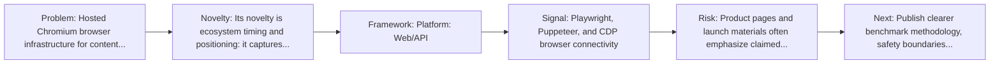
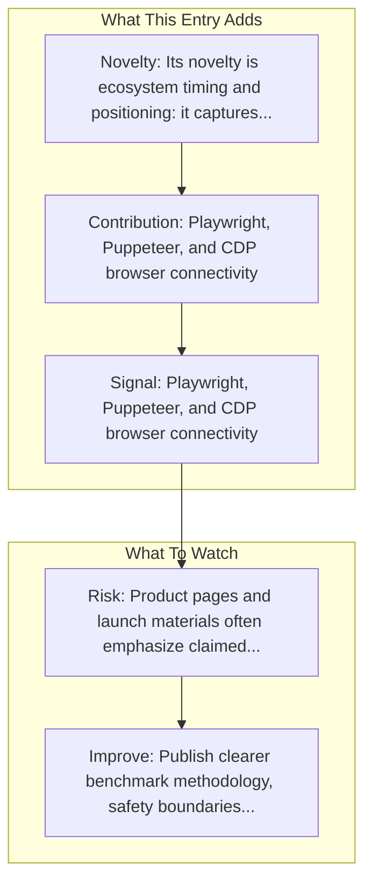

# AdsCrawl

Entry report generated on 2026-11-08 (Asia/Shanghai) from the repository entry and linked official documentation. No live API test, independent benchmark, or adoption audit was performed.

## Snapshot

| Field | Detail |
| --- | --- |
| Repo entry | AdsCrawl |
| Actual target | [Website](https://www.adscrawl.net/) |
| Group | Products & Services |
| Category | Browser Infrastructure Services |
| Source location | `products/README.md:265` |
| Primary link type | `product` |
| Status | Available hosted service (no official GA/Beta designation documented) |
| Platform | Web/API |
| Company | AdsCrawl |
| Related assets | [API Docs](https://api.adscrawl.net/docs/agent-quickstart.md) |

## Quick Read

| Lens | Read |
| --- | --- |
| Role in repo | product |
| Novelty | Its novelty is ecosystem timing and positioning: it captures how a vendor chose to frame computer use as a product capability. |
| Operating frame | Platform: Web/API |
| Main caution | Product pages and launch materials often emphasize claimed capability more than independent evaluation or failure analysis. |

## Visual Frame

## Analysis Map

## Executive Summary

Hosted Chromium browser infrastructure for content extraction and browser automation. Key local notes: Playwright, Puppeteer, and CDP browser connectivity; POST /html with contentMode: markdown for rendered Markdown content.

## Novelty and Distinguishing Angle

- Its novelty is ecosystem timing and positioning: it captures how a vendor chose to frame computer use as a product capability.
- The entry is browser-first, matching the part of the ecosystem that currently looks most deployment-ready.

## Core Contributions or Offerings

- Playwright, Puppeteer, and CDP browser connectivity
- POST /html with contentMode: markdown for rendered Markdown content
- POST /spa-extract for structured field extraction
- POST /screenshot for PNG screenshots
- Separate reusable Cloud Browser profile lifecycle

## Operating Framework

- Platform: Web/API
- Status: Available hosted service (no official GA/Beta designation documented)

## Evidence and Adoption Signals

- Playwright, Puppeteer, and CDP browser connectivity
- POST /html with contentMode: markdown for rendered Markdown content

## Limitations and Gaps

- Product pages and launch materials often emphasize claimed capability more than independent evaluation or failure analysis.
- External evidence density is thin for this entry, so the report depends mostly on repo-local framing.

## Improvement Paths

- Publish clearer benchmark methodology, safety boundaries, and real deployment limits alongside capability claims.
- Keep changelogs and API or availability notes current so the repo can track product evolution without guesswork.
- Add more concrete examples of failure handling, fallback behavior, and human takeover boundaries.

## Why It Matters

- It shows how computer-use ideas are being packaged into deployable products, not only benchmark papers.
- That product layer matters because it exposes which capabilities companies think are ready for users or enterprises.

## Connections In This Repo

- [Browserbase](browser-infrastructure-services-browserbase.md) - neighboring ecosystem entry in the same local cluster.
- [Browserless](browser-infrastructure-services-browserless.md) - neighboring ecosystem entry in the same local cluster.
- [Anthropic - Claude Computer Use](major-tech-companies-anthropic-claude-computer-use.md) - neighboring ecosystem entry in the same local cluster.
- [OpenAI - Operator / CUA](major-tech-companies-openai-operator-cua.md) - neighboring ecosystem entry in the same local cluster.

## Source Basis

- Primary basis: repo-local notes.
- Capability reference: [Official product overview](https://www.adscrawl.net/).
- API reference and request example: [Official agent quickstart](https://api.adscrawl.net/docs/agent-quickstart.md).
